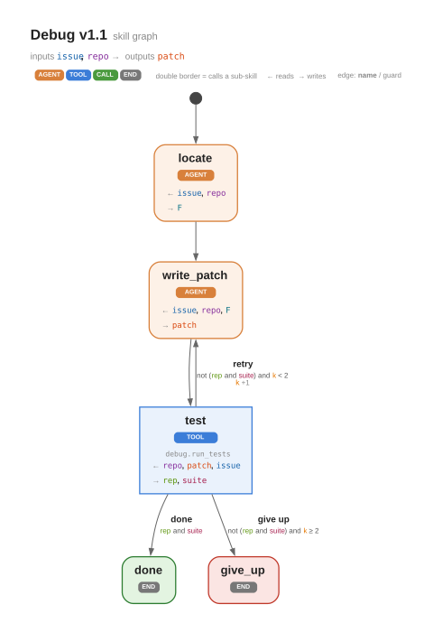
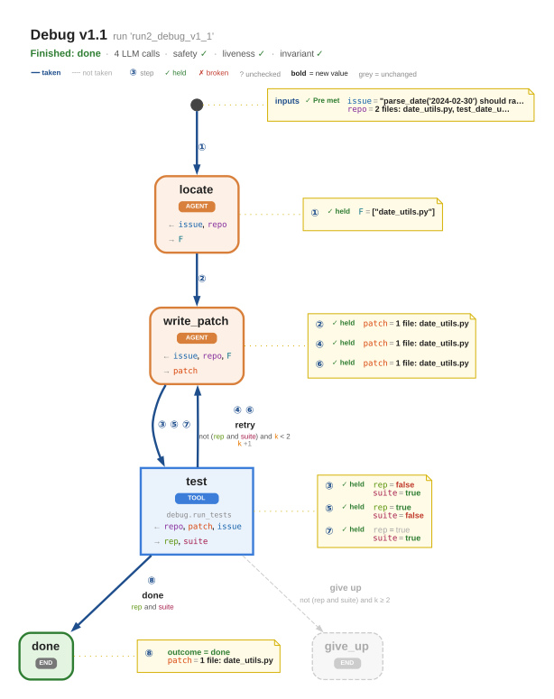

# Liskov-Gödel Machine

Agent 递归自我改进（Recursive Self-Improvement, RSI）研究：把 agent 的 skill 表示成**带契约的图**，在入库前做良构性检查和接口精化（Liskov 替换）检查，为失败驱动的 skill 修复与修复候选的形式化比较打基础。

当前代码是第一步 `skillgraph`：skill 的图结构、良构性检查、执行与轨迹、缓存重放、接口精化与版本库。**还不含进化**（归责、编辑与比较）。

## 示例

<table>
<tr>
<td align="center"><b>Skill 图：Debug v1.1</b></td>
<td align="center"><b>一次运行叠加在 skill 图上的数据流</b></td>
</tr>
<tr>
<td></td>
<td></td>
</tr>
</table>

更多运行轨迹见 [`assets/`](assets/)：不变式被破坏后放弃（`run_inv_violation_cheat.svg`）、前置条件不满足被拒绝（`run_reject_no_repro.svg`）、缓存重放停在重放边界（`run_replay_debug_v1_1.svg`）。

## 快速开始

```bash
pip install -r requirements.txt            # 只依赖 PyYAML；测试另需 pytest
python examples/run_toys.py                # 六个 coding toy example，SVG 输出到 examples/output/
python -m pytest tests -q                  # 测试
python -m skillgraph check examples/skills                       # 对一个目录做入库检查
python -m skillgraph show  examples/skills Coding coding.svg     # 渲染成 SVG（需要 Graphviz 的 dot）
```

## 目录

```
skillgraph/     核心实现（模块说明与设计细化见 skillgraph/README.md）
examples/       toy world、YAML 定义的示例 skill、run_toys.py
tests/          pytest 测试
assets/         README 用到的精选图
```
